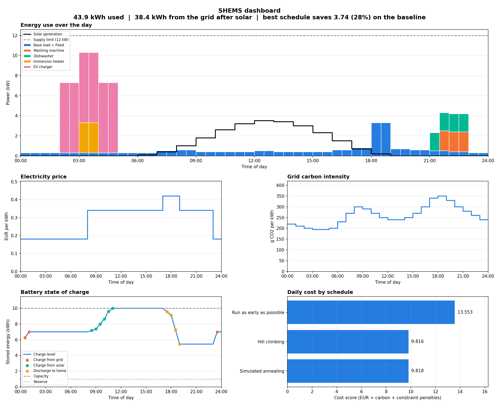

# Smart Home Energy Management System (SHEMS)

[](https://github.com/SeanneDSAI/smart-home-energy-management-system/actions/workflows/tests.yml)

A knowledge-driven AI system that schedules home appliances and battery use to cut electricity cost and carbon under time-of-use tariffs.

**Module:** AINL3001 Knowledge-Driven AI · **Group:** Dream Team Wallahi

SHEMS decides **when to run flexible appliances** (dishwasher, washing machine, EV charger, immersion heater) and **how to use a home battery**. It works across a 24-hour day split into 48 half-hour slots and respects:

- time-of-use electricity prices (night / day / peak)
- appliance deadlines (e.g. laundry done by 07:00)
- the home's main supply limit
- quiet hours for noisy appliances
- solar generation and home occupancy

See [proposal.md](proposal.md) for the full problem description and design.



## AI techniques

| Technique | File | Status |
|---|---|---|
| Knowledge representation (knowledge graph of devices, tariff, occupancy) | [src/knowledge_base.py](src/knowledge_base.py) | Done |
| Rule-based expert system (forward chaining with explanations) | [src/rules.py](src/rules.py) | Done |
| Slot-by-slot battery controller driven by the rules | [src/controller.py](src/controller.py) | Done |
| Constraint satisfaction: node consistency, then backtracking with MRV and forward checking | [src/csp.py](src/csp.py) | Done |
| Local search: random-restart hill climbing and simulated annealing over cost + carbon | [src/localsearch.py](src/localsearch.py) | Done |
| Scheduler: runs the baseline and both searches, and picks the best schedule | [src/scheduler.py](src/scheduler.py) | Done |
| Charts and a one-page dashboard of the simulated day | [src/visualisation.py](src/visualisation.py) | Done |
| Interactive menu that ties everything together | [main_cli.py](main_cli.py) | Done |

### How the pieces fit

1. **Knowledge base.** A scenario's four JSON files are loaded into a knowledge graph. Every other module asks it questions, such as an appliance's power, the price in a slot, or whether a slot is in quiet hours.
2. **CSP model.** `make_problem` turns the knowledge base into a CSP. The variables are the flexible appliances, each domain is the set of start slots that fit the appliance's time window, and the constraints are quiet hours and the supply limit. `is_valid` checks a full schedule, and `backtracking_search` finds valid schedules.
3. **Local search.** Hill climbing (with 20 random restarts) and simulated annealing look for the cheapest schedule. The cost function is:

   ```text
   cost = money (EUR) + 0.000083 × carbon (g CO2) + 10 × constraint violations
   ```

   The carbon weight is roughly the EU carbon market price per gram. A violation is each kW over the supply limit, and each slot in which a noisy appliance runs during quiet hours.
4. **Rule-based controller.** For each half hour, forward chaining over the rules decides whether the battery charges from the grid, charges from solar, discharges or does nothing. It also gives advice, such as not running noisy appliances in quiet hours. Every decision comes with a written reason.
5. **Visualisation.** The schedule and the controller's battery log are drawn as charts and combined into a dashboard.

## Requirements

- Python 3.10 or newer
- The AI code (knowledge base, rules, controller, CSP and local search) uses only the standard library.
- [matplotlib](https://matplotlib.org) is needed for the charts and the dashboard.
- [pytest](https://pytest.org) is needed to run the tests.

Both are listed in [requirements.txt](requirements.txt).

## Setup

```bash
git clone https://github.com/SeanneDSAI/smart-home-energy-management-system
cd smart-home-energy-management-system

python -m venv .venv
# Windows
.venv\Scripts\activate
# macOS / Linux
source .venv/bin/activate

pip install -r requirements.txt
```

## Usage

Run every command from the repository root.

### Interactive menu (recommended)

```bash
python main_cli.py                           # uses data/scenarios/example
python main_cli.py data/scenarios/<name>     # any other scenario
```

```text
=======================================
 Scenario: data/scenarios/example
---------------------------------------
 1  Show the scenario
 2  Find the best schedule
 3  Run the battery controller
 4  Make charts (saved to outputs/example/)
 5  Switch scenario
 q  Quit
=======================================
```

| Option | What it does |
|---|---|
| 1 | Summarises the house, appliances, tariff, occupancy, solar and battery. |
| 2 | Runs hill climbing and simulated annealing, compares them with a "run as early as possible" baseline, and prints the best schedule. |
| 3 | Runs the rule-based battery controller for the day and prints each slot where it acts or gives advice, with the reason. |
| 4 | Saves the charts and dashboard to `outputs/<scenario>/images/` and the numbers behind them to `outputs/<scenario>/data/`, then offers to open the charts in a window. |
| 5 | Lists every scenario in `data/scenarios/` and switches to the one you pick, without restarting. |

The searches are random, so the menu uses a fixed seed (`SEED = 1` in [main_cli.py](main_cli.py)). Each run gives the same results, so the numbers in the report and the demo always match.

Example output of option 2 on the example scenario:

```text
  Schedule                       Cost  Valid
  Run as early as possible     13.553  yes
  Hill climbing                 9.816  yes
  Simulated annealing           9.818  yes

Best schedule (Hill climbing):

  Appliance              kW  Runs
  washing_machine       2.0  21:30-23:00  (noisy)
  dishwasher            1.8  21:00-23:00  (noisy)
  immersion_heater      3.0  03:00-04:00
  ev_charger            7.0  02:00-05:00
```

The optimised schedule scores about 28% lower than the baseline. It moves the EV charger and immersion heater onto the cheap night rate and finishes the noisy appliances before quiet hours start at 23:00.

Example output of option 3:

```text
00:00  soc= 6.25 kWh  demand= 0.3 kW  charge_grid  cheap night rate and the battery is below its overnight target (room kept for tomorrow's solar); ...
01:00  soc=  7.0 kWh  demand= 0.3 kW  -            quiet hours, so do not run noisy appliances
08:00  soc= 7.18 kWh  demand= 0.6 kW  charge_solar spare solar beyond the home's demand, with room in the battery
17:00  soc= 9.56 kWh  demand= 0.8 kW  discharge    peak tariff, so importing now is costly; costly period and the battery has usable charge; ...
```

**Note:** the battery controller does not yet take the scheduled flexible appliances into account. It works from the base load and fixed appliances only.

### Running modules on their own

```bash
python -m src.knowledge_base [scenario]           # summarise a scenario
python -m src.controller                          # battery controller for the example day
python -m src.localsearch                         # random start, hill climbing, then random-restart hill climbing
python -m src.visualisation [scenario] [out_dir]  # write charts and data (default out_dir: outputs/<scenario>/)
```

### Evaluation

```bash
python -m src.evaluation
```

For each scenario in `data/scenarios/`, this compares backtracking with and without MRV and forward checking, the local search algorithms over 10 seeded runs, and the cost, carbon and grid energy before and after optimisation. It also finds the true optimum by exhaustive search and measures how far each local search ends from it. A saved run is in [outputs/evaluation/data/evaluation_results.txt](outputs/evaluation/data/evaluation_results.txt); to update it, run `python -m src.evaluation > outputs/evaluation/data/evaluation_results.txt`. The exhaustive search on `high_solar` checks about 1.4 million schedules and takes from 30 seconds to a minute and a half, depending on the machine.

```bash
python -m src.evaluation_charts              # charts of the evaluation, saved to outputs/evaluation/images/
python -m src.evaluation_charts --refresh    # rerun the searches instead of reusing the saved numbers
```

The first run does the same searches as `evaluation.py` and saves the numbers to `outputs/evaluation/data/results.json`. Later runs redraw the charts from that file in a few seconds.

### Using the CSP solver from Python

```python
from src.knowledge_base import load_knowledge_base
from src.csp import make_problem, backtracking_search, is_valid

kb = load_knowledge_base("data/scenarios/example")
problem = make_problem(kb)

schedules, nodes = backtracking_search(problem)              # first valid schedule
every, nodes = backtracking_search(problem, limit=None)      # every valid schedule
plain, nodes = backtracking_search(problem, use_mrv=False,
                                   use_forward_checking=False)  # compare the heuristics
```

A schedule is a list of start slots, one per flexible appliance, in the order of `problem["names"]`. The CSP and the local search share this format, so `is_valid(problem, schedule)` can check a result from either. `nodes` counts the search nodes visited, which shows how much MRV and forward checking prune.

## Charts and dashboard

Every output goes in `outputs/`, one folder per scenario plus one for the evaluation, each split into `images/` and `data/`:

```text
outputs/
├── example/
│   ├── images/        # charts and dashboard
│   └── data/          # day.csv, schedules.csv
├── high_solar/
├── no_solar_battery/
├── restricted_supply/
└── evaluation/
    ├── images/        # charts comparing the scenarios
    └── data/          # results.json, evaluation_results.txt
```

Option 4 in the menu, or `python -m src.visualisation`, writes these to `outputs/<scenario>/`:

| File | Shows |
|---|---|
| `images/energy_use.png` | Demand by source (stacked) using the optimised schedule, with solar generation and the supply limit |
| `images/electricity_price.png` | Tariff price over the day |
| `images/carbon_intensity.png` | Grid carbon intensity over the day |
| `images/battery.png` | Battery state of charge, with a marker for each controller action (only if the scenario has a battery) |
| `images/schedule_cost.png` | Cost of the baseline against hill climbing and simulated annealing |
| `images/dashboard.png` | All of the above on one page, with a headline of energy used, grid import and savings |
| `data/day.csv` | Slot by slot: demand by source, total demand, solar, grid import, price, carbon, battery charge and action |
| `data/schedules.csv` | Each schedule's cost, whether it is valid, and when each appliance runs |

`python -m src.evaluation_charts` compares all the scenarios and writes these to `outputs/evaluation/`:

| File | Shows |
|---|---|
| `images/savings_by_scenario.png` | Cost, carbon and grid energy for the "run as early as possible" baseline against the optimised schedule, in every scenario |
| `images/algorithm_scaling.png` | How far hill climbing, random restart and simulated annealing end from the true optimum in each scenario, and how many schedules the exhaustive search must check to find it |
| `data/results.json` | The numbers both charts are drawn from |
| `data/evaluation_results.txt` | Saved output of `evaluation.py` |

## Tests

```bash
pytest -v
```

There are 120 tests:

| File | Tests | Covers |
|---|---|---|
| [tests/test_knowledge_base.py](tests/test_knowledge_base.py) | 15 | Time and slot conversion, wrapping past midnight, graph queries, tariff boundaries, solar and battery, bad input |
| [tests/test_rules.py](tests/test_rules.py) | 21 | Each rule fires when it should and not otherwise, chaining, explanations, and the controller over a full day: demand, night charging, peak discharge, the battery staying within limits, and a house with no battery |
| [tests/test_csp.py](tests/test_csp.py) | 30 | Start-time domains (including past midnight), quiet hours, the supply limit with solar, node consistency, MRV, forward checking, backtracking with and without heuristics, impossible problems |
| [tests/test_localsearch.py](tests/test_localsearch.py) | 22 | Random states, the cost function (money, carbon, solar, both penalties), neighbours, hill climbing, random restarts and simulated annealing |
| [tests/test_integration.py](tests/test_integration.py) | 5 | Every scenario in `data/scenarios/` loads and runs through the CSP, local search, controller and charts |
| [tests/test_visualisation.py](tests/test_visualisation.py) | 6 | Day data has 48 slots, demand adds up and wraps past midnight, every chart is written to `images/`, and `day.csv` and `schedules.csv` are written to `data/` |
| [tests/test_scheduler.py](tests/test_scheduler.py) | 5 | The baseline comes first, every schedule is valid, the searches beat the baseline, and the best schedule is never the baseline unless it is the only one |
| [tests/test_evaluation_charts.py](tests/test_evaluation_charts.py) | 7 | Both evaluation charts are written to `images/`, results are saved under `data/`, saved results are reused (and rerun on `--refresh`), and the example scenario's numbers are sensible |
| [tests/test_cli.py](tests/test_cli.py) | 9 | The menu quits, options 1–3 run, and option 5 lists and switches scenarios, rejects a bad choice, and sends each scenario's charts to its own folder |

All of them except `test_visualisation.py`, `test_scheduler.py`, `test_evaluation_charts.py` and `test_cli.py` also run without pytest, e.g. `python tests/test_rules.py`.

GitHub Actions ([.github/workflows/tests.yml](.github/workflows/tests.yml)) runs the full suite on Python 3.10 and 3.12 for every push and pull request to `main`.

## Project structure

```text
smart-home-energy-management-system/
├── .github/workflows/
│   └── tests.yml             # CI: runs pytest on Python 3.10 and 3.12
├── data/
│   └── scenarios/            # one scenario = four JSON files
│       ├── example/
│       │   ├── appliances.json
│       │   ├── home.json
│       │   ├── occupancy.json
│       │   └── tariff.json
│       ├── high_solar/
│       ├── no_solar_battery/
│       └── restricted_supply/
├── outputs/                  # charts (images/) and data files (data/), one folder per scenario + evaluation/
├── src/
│   ├── knowledge_base.py     # loads scenarios, knowledge graph, queries, facts per slot
│   ├── rules.py              # rule set and forward chaining
│   ├── controller.py         # runs the rules across the day, manages the battery
│   ├── csp.py                # CSP model, constraints, backtracking with MRV + forward checking
│   ├── localsearch.py        # cost function, hill climbing, simulated annealing
│   ├── scheduler.py          # runs the baseline and both searches, picks the best schedule
│   ├── visualisation.py      # charts and dashboard for one scenario
│   ├── evaluation.py         # compares the algorithms across every scenario
│   └── evaluation_charts.py  # charts comparing the scenarios
├── tests/
├── main_cli.py               # interactive menu
├── proposal.md
├── requirements.txt
└── README.md
```

## Scenario format

A scenario is a folder holding four JSON files. Times are `"HH:MM"` strings on the hour or half hour, from `00:00` to `24:00`. A time window can wrap past midnight, e.g. `"18:00"` to `"07:00"`.

**`appliances.json`** is a list of appliances, each either flexible or fixed:

```json
{ "name": "dishwasher", "power_kw": 1.8, "duration_minutes": 120,
  "flexible": true, "noisy": true, "earliest": "20:00", "latest_finish": "07:00" }

{ "name": "oven", "power_kw": 2.5, "duration_minutes": 60,
  "flexible": false, "start": "18:00" }
```

**`home.json`** holds the supply limit, a 24-value hourly base load, and optionally a 24-value hourly solar profile and a battery:

```json
{ "supply_limit_kw": 12.0,
  "base_load_kw_hourly": [0.3, 0.3, "... 24 values"],
  "solar_kw_hourly":     [0, 0, "... 24 values"],
  "battery": { "capacity_kwh": 10.0, "max_charge_kw": 5.0, "max_discharge_kw": 5.0,
               "initial_charge_kwh": 4.0, "min_charge_kwh": 1.0, "efficiency": 0.9 } }
```

**`occupancy.json`** lists the time ranges when someone is home and the quiet hours:

```json
{ "home":  [["00:00", "08:30"], ["17:30", "24:00"]],
  "quiet": [["23:00", "07:00"]] }
```

**`tariff.json`** holds the price periods, which must cover every slot exactly once, and a 24-value hourly carbon intensity:

```json
{ "periods": [
    { "name": "night", "times": [["23:00", "08:00"]], "price_eur_per_kwh": 0.18 },
    { "name": "day",   "times": [["08:00", "17:00"], ["19:00", "23:00"]], "price_eur_per_kwh": 0.34 },
    { "name": "peak",  "times": [["17:00", "19:00"]], "price_eur_per_kwh": 0.42 } ],
  "carbon_g_per_kwh_hourly": [220, 210, "... 24 values"] }
```

The example prices are illustrative and follow the structure of Irish smart time-of-use tariffs.

To add a scenario, copy `data/scenarios/example/` to a new folder and edit the files. A flexible appliance whose time window is shorter than its run time is rejected when the problem is built.

## Team

| Name | Role | GitHub |
|---|---|---|
| Dillon Thornton | Knowledge Base & Data Model | [dillon329](https://github.com/dillon329) |
| Alex Rolff | CSP Scheduler & Search | [roflalex](https://github.com/roflalex) |
| Seanne Oriemo | Rule-Based Controller | [SeanneDSAI](https://github.com/SeanneDSAI) |
| Arshdip Chera | Local Search & Optimisation | [AshACxx](https://github.com/AshACxx) |
| Karl Ypil | Testing & Evaluation | [Kpil06](https://github.com/Kpil06) |
| Allen Lapitan | Integration & Documentation | [lentenamen](https://github.com/lentenamen) |
