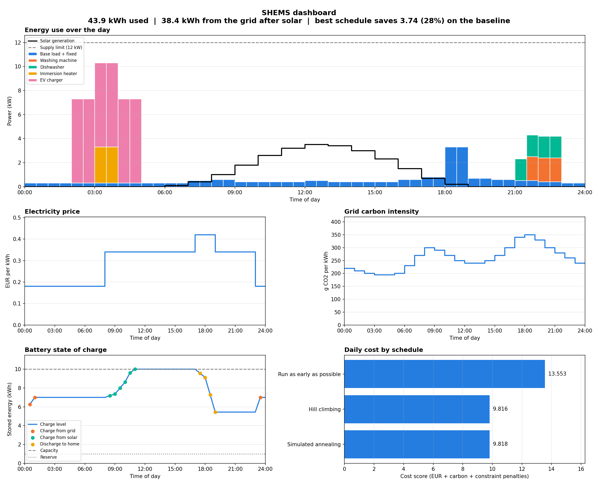

# Smart Home Energy Management System (SHEMS)

[](https://github.com/SeanneDSAI/smart-home-energy-management-system/actions/workflows/tests.yml)

Knowledge-driven AI system that schedules home appliances and battery use to cut electricity cost and carbon under time-of-use tariffs.

**Module:** AINL3001 Knowledge-Driven AI · **Group:** Dream Team Wallahi

SHEMS decides **when to run flexible appliances** (dishwasher, washing machine, EV charger, immersion heater) and **how to use a home battery**. It works across a 24-hour day split into 48 half-hour slots and respects:

- time-of-use electricity prices (night / day / peak)
- appliance deadlines (e.g. laundry done by 07:00)
- the home's main supply limit
- quiet hours for noisy appliances
- solar generation and home occupancy

See [proposal.md](proposal.md) for the full problem description and design.



## AI techniques

| Technique | File | Status |
|---|---|---|
| Knowledge representation (knowledge graph of devices, tariff, occupancy) | [src/knowledge_base.py](src/knowledge_base.py) | Done |
| Rule-based expert system (forward chaining with explanations) | [src/rules.py](src/rules.py) | Done |
| Slot-by-slot battery controller driven by the rules | [src/controller.py](src/controller.py) | Done |
| Constraint satisfaction: constraint model and validity checks (time windows, quiet hours, supply limit) | [src/csp.py](src/csp.py) | Done |
| Constraint satisfaction: backtracking with MRV and forward checking | [src/csp.py](src/csp.py) | In progress |
| Local search: random-restart hill climbing and simulated annealing over cost + carbon | [src/localsearch.py](src/localsearch.py) | Done |
| Visualisation: charts and a one-page dashboard of the day | [src/visualisation.py](src/visualisation.py) | Done |

## Requirements

- Python 3.10 or newer
- [matplotlib](https://matplotlib.org) for the charts and dashboard. Everything else uses the standard library.
- [pytest](https://pytest.org) for running the tests.

Both are in `requirements.txt`.

## Setup

```bash
git clone https://github.com/SeanneDSAI/smart-home-energy-management-system
cd smart-home-energy-management-system

python -m venv .venv
# Windows
.venv\Scripts\activate
# macOS / Linux
source .venv/bin/activate

pip install -r requirements.txt
```

## Usage

Run every command from the repository root.

### Interactive menu

The easiest way to use SHEMS is the menu-driven CLI:

```bash
python main_cli.py                         # uses data/scenarios/example
python main_cli.py data/scenarios/<name>   # any other scenario
```

| Option | What it does |
|---|---|
| `1` Show the scenario | Summarises the house, appliances, tariff, occupancy, solar and battery |
| `2` Find the best schedule | Runs hill climbing and simulated annealing, compares them with a "run as early as possible" baseline, and prints the cheapest valid schedule |
| `3` Run the battery controller | Runs the rule-based controller across the day (see below) |
| `4` Make charts | Saves the charts to `images/` and can open them in a window |
| `q` Quit | |

The searches are random, but the CLI uses a fixed seed (`SEED = 1` in [main_cli.py](main_cli.py)), so every run gives the same results. That keeps the numbers in the report and the demo consistent.

### Individual modules

Each module can also be run on its own.

**Summarise a scenario** (house, appliances, tariff, occupancy, solar and battery):

```bash
python -m src.knowledge_base                         # uses data/scenarios/example
python -m src.knowledge_base data/scenarios/<name>   # any other scenario
```

**Run the rule-based controller for a day.** This prints each slot where the battery acts or advice is given, with the reason:

```bash
python -m src.controller
```

Example output:

```text
00:00  soc= 6.25 kWh  demand= 0.3 kW  charge_grid  cheap night rate and the battery is below its overnight target ...
01:00  soc=  7.0 kWh  demand= 0.3 kW  -            quiet hours, so do not run noisy appliances
```

> The controller does not yet take the scheduled flexible appliances into account. Its demand figures are the base load and fixed appliances only.

**Make the charts and dashboard:**

```bash
python -m src.visualisation                                  # example scenario, saved to images/
python -m src.visualisation data/scenarios/<name> <out_dir>  # any scenario and output folder
```

| File | Shows |
|---|---|
| `energy_use.png` | Household demand by source (stacked) under the optimised schedule, with solar generation and the supply limit |
| `electricity_price.png` | Tariff price over the day |
| `carbon_intensity.png` | Grid carbon intensity over the day |
| `battery.png` | Battery state of charge and each controller action (only when the scenario has a battery) |
| `schedule_cost.png` | Cost of the baseline compared with each search algorithm's schedule |
| `dashboard.png` | All of the above on one page, with headline figures |
The "cost" in these charts is a **cost score**: euros, plus a carbon term, plus penalties for broken constraints. It is good for comparing schedules but is not the actual bill.

## Tests

```bash
pytest
```

Tests cover the knowledge base, the rules, the CLI and the visualisation. They run automatically on GitHub Actions (Python 3.10 and 3.12) for every push and pull request to `main`.

## Project structure

```text
smart-home-energy-management-system/
├── .github/
│   └── workflows/
│       └── tests.yml         # runs pytest on GitHub Actions
├── data/
│   └── scenarios/
│       └── example/          # one scenario = four JSON files
│           ├── appliances.json
│           ├── home.json
│           ├── occupancy.json
│           └── tariff.json
├── images/                   # charts and dashboard written by src/visualisation.py
├── src/
│   ├── knowledge_base.py     # loads scenarios, knowledge graph, queries, facts per slot
│   ├── rules.py              # rule set and forward chaining
│   ├── controller.py         # runs the rules across the day, manages the battery
│   ├── csp.py                # CSP model and constraint checks for flexible appliances
│   ├── localsearch.py        # hill climbing and simulated annealing over cost + carbon
│   └── visualisation.py      # charts and dashboard
├── tests/
│   ├── test_cli.py
│   ├── test_knowledge_base.py
│   ├── test_rules.py
│   └── test_visualisation.py
├── main_cli.py               # interactive menu
├── proposal.md
├── requirements.txt
└── README.md
```

## Scenario format

A scenario is a folder holding four JSON files. Times are `"HH:MM"` strings on the hour or half hour, from `00:00` to `24:00`. A time window can wrap past midnight, e.g. `"18:00"` to `"07:00"`.

**`appliances.json`** is a list of appliances, each either flexible or fixed:

```json
{ "name": "dishwasher", "power_kw": 1.8, "duration_minutes": 120,
  "flexible": true, "noisy": true, "earliest": "20:00", "latest_finish": "07:00" }

{ "name": "oven", "power_kw": 2.5, "duration_minutes": 60,
  "flexible": false, "start": "18:00" }
```

**`home.json`** holds the supply limit, a 24-value hourly base load, and optionally a 24-value hourly solar profile and a battery:

```json
{ "supply_limit_kw": 12.0,
  "base_load_kw_hourly": [0.3, 0.3, "... 24 values"],
  "solar_kw_hourly":     [0, 0, "... 24 values"],
  "battery": { "capacity_kwh": 10.0, "max_charge_kw": 5.0, "max_discharge_kw": 5.0,
               "initial_charge_kwh": 4.0, "min_charge_kwh": 1.0, "efficiency": 0.9 } }
```

**`occupancy.json`** lists the time ranges when someone is home and the quiet hours:

```json
{ "home":  [["00:00", "08:30"], ["17:30", "24:00"]],
  "quiet": [["23:00", "07:00"]] }
```

**`tariff.json`** holds the price periods, which must cover every slot exactly once, and a 24-value hourly carbon intensity:

```json
{ "periods": [
    { "name": "night", "times": [["23:00", "08:00"]], "price_eur_per_kwh": 0.18 },
    { "name": "day",   "times": [["08:00", "17:00"], ["19:00", "23:00"]], "price_eur_per_kwh": 0.34 },
    { "name": "peak",  "times": [["17:00", "19:00"]], "price_eur_per_kwh": 0.42 } ],
  "carbon_g_per_kwh_hourly": [220, 210, "... 24 values"] }
```

The example prices are illustrative and use the Irish smart time-of-use structure.

To add a scenario, copy `data/scenarios/example/` to a new folder and edit the files.

## Team

| Name | Role | GitHub |
|---|---|---|
| Dillon Thornton | Knowledge Base & Data Model | [dillon329](https://github.com/dillon329) |
| Alex Rolff | CSP Scheduler & Search | [roflalex](https://github.com/roflalex) |
| Seanne Oriemo | Rule-Based Controller | [SeanneDSAI](https://github.com/SeanneDSAI) |
| Arshdip Chera | Local Search & Optimisation | [AshACxx](https://github.com/AshACxx) |
| Karl Ypil | Testing & Evaluation | [Kpil06](https://github.com/Kpil06) |
| Allen Lapitan | Integration & Documentation | [lentenamen](https://github.com/lentenamen) |
